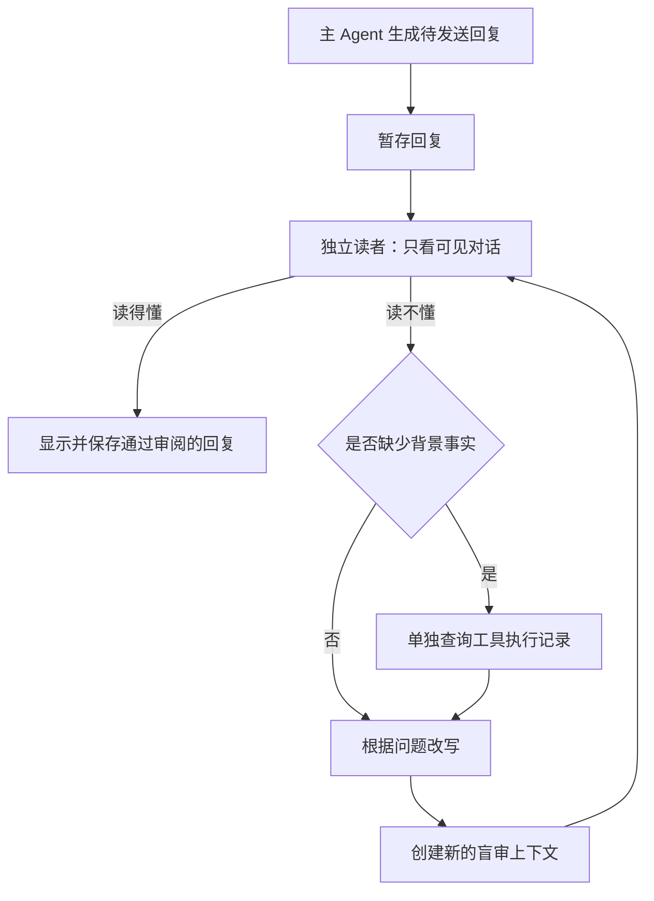

# Human Harness：让 Pi 的回复更容易读懂

这个仓库基于 [Pi](https://github.com/earendil-works/pi)，在每条即将展示给用户的模型回复前，增加一个独立的读者 Agent。

读者只看用户输入、此前用户可见的助手文字和本次待发送的回复。如果它读不懂，会提出具体问题；只有需要核实背景时，才由另一次调用查询执行记录，再改写回复。改写后，重新建立一个没有看过执行记录的读者上下文，检查用户现在是否能读懂。

例如，Agent 在工具执行过程中把“重试失败的导出任务”叫作“蓝桥”，最后却只告诉用户“蓝桥收口了”。用户没有见过这个定义。Humanize 会发现这类缺失，并根据记录把它改成具体、可理解的说明。

## 可视化实验室

[打开轨迹对比页面](https://hzeroyuke.github.io/human_harness/) · [可视化分支](https://github.com/hzeroyuke/human_harness/tree/feat/trajectory-explorer)

页面按模型和任务展示开启、关闭 Humanize 时的回复，可展开每轮盲审、查证和改写的实际请求、返回、用量与耗时，也可下载完整 JSON。接口失败和未通过审阅的记录同样保留。

实验包含两种模式：**固定草稿**让不同模型审阅相同内容；**模型生成**先让各模型根据合成执行记录生成草稿，再对同一份草稿开启审阅。执行记录中的开发、分析和客服操作都没有实际发生。两种模式分别展示，不混成模型排名；读者批准也不代表事实正确。

本批尝试了代理目录中的 **15 个文本模型、8 类任务，共 150 次尝试**：120 组固定草稿，30 次模型生成尝试。后者仅 10 次成功生成原始回复，另外 20 次因接口或连接异常没有可对比的草稿。其中 45 组改写后通过、21 组原样通过、84 组失败、0 组调用不可用。失败中 24 组涉及接口或连接异常，不能归因为回复难懂。另有 3 个向量模型不能生成对话，未纳入矩阵。

[查看中文实测汇总与原文对比](examples/humanize/benchmark-summary.md)。实测也记录了读者过度查证、反复拦截的情况；这些数据用于检查具体行为，不代表稳定的模型排名。

本地预览、复现实验和 Pages 发布方法见 [轨迹实验说明](docs/trajectory-pages.md)。

## 快速开始

需要 Node.js 22.19 或更新版本。

```bash
git clone git@github.com:hzeroyuke/human_harness.git
cd human_harness
npm ci --ignore-scripts
npm run hydrate:model-data
./pi-humanize.sh
```

`hydrate:model-data` 使用上游命令下载运行所需的模型目录。模型认证沿用 Pi 配置，可在 Pi 内运行 `/login`。默认使用主 Agent 的模型进行审阅，也能单独选择读者模型。

```bash
# 开启：每条有文字的模型回复先经过读者审阅
PI_HUMANIZE=1 ./pi-humanize.sh

# 关闭：沿用 Pi 原有的流式输出
PI_HUMANIZE=0 ./pi-humanize.sh
```

`pi-humanize.sh` 默认开启；原有 `pi-test.sh` 和 SDK 默认关闭。也可以在 `.pi/settings.json` 中设置：

```json
{
  "humanize": {
    "enabled": true,
    "maxRevisions": 2,
    "timeoutMs": 90000,
    "maxContextChars": 48000
  }
}
```

环境变量优先于配置。完整配置、SDK 用法和本机 Copilot 反代配置见 [中文使用说明](HUMANIZE.md)。

## 开启与关闭的轨迹对比

以下对照使用相同的用户输入、执行记录和待发送文本。**主 Agent 草稿与执行记录是合成测试数据，其中描述的工作没有实际执行；审阅、查证、改写和复审调用了真实模型。** 这样可以比较功能本身的影响，避免两次主模型随机生成不同答案。

关闭时原文直接展示，辅助调用为零。开启时运行本仓库的实际审阅引擎。完整的每步请求、模型原始返回与用量见 [轨迹记录](examples/humanize/trajectories.md) 和 [JSON 数据](examples/humanize/trajectories.json)。这些例子用于检查流程，不代表总体效果评测。

本次实测模型：`gemini-3.8-flash`，通过 Copilot 本地反代调用；接口为 `openai-completions`。

### 轨迹一：用户从未见过的内部术语

**用户输入**

> 导出任务现在是什么状态？请用日常语言告诉我进展。

**工具执行记录中的背景（首次盲审看不到）**

> 蓝桥：失败后自动重试导出任务的流程。收口：已将该流程中所有仍在重试的导出任务处理完毕。玻璃窗：上线后持续观察日志、确认是否出现新增导出失败的阶段。状态：重试中的导出任务已处理完，正在观察后续导出，尚不能保证不会再失败。

**关闭时看到**

> 已完成蓝桥收口，进入玻璃窗阶段。

**开启时看到**

> 之前重试中的导出任务已经全部处理完毕。目前进入了持续观察阶段，正在查看日志以确认是否会出现新的导出失败，暂时还不能保证后续不会再失败。

实际轨迹：盲审 → 查证执行记录 → 改写 → 全新盲审通过。

辅助调用 4 次，改写 1 次，读取执行记录 1 次。

### 轨迹二：前者、后者、那边分别是什么

**用户输入**

> 我现在能用新版本了吗？还有什么没完成，请说清楚。

**工具执行记录中的背景（首次盲审看不到）**

> 本次内部代指：前者=公司员工使用的测试网站；后者=普通用户使用的正式网站；那边=提供登录验证的外部服务；放行=允许普通用户登录新版本。当前状态：测试网站已经切换到新版本。正式网站仍使用旧版本，发布暂停，原因是外部登录验证服务故障。故障恢复后还需检查登录是否正常，检查通过才发布新版本；目前不能让普通用户使用新版本。

**关闭时看到**

> 前者已切换，后者仍挂起；等那边恢复后再放行。

**开启时看到**

> 目前普通用户还不能使用新版本。公司员工使用的测试网站已切换到新版本，但普通用户使用的正式网站仍使用旧版本，且发布已暂停。目前未完成的事项包括：需等待提供登录验证的外部服务故障恢复，恢复后还需检查登录是否正常，检查通过后才会发布正式网站的新版本。

实际轨迹：盲审 → 查证执行记录 → 改写 → 全新盲审通过。

辅助调用 4 次，改写 1 次，读取执行记录 1 次。

### 轨迹三：本来清楚的回复保持原样

**用户输入**

> 请把数据导出到 output.csv，并告诉我是否完成。

这一组没有提供执行记录。

**关闭时看到**

> 导出任务已经完成，文件保存在 output.csv。

**开启时看到**

> 导出任务已经完成，文件保存在 output.csv。

实际轨迹：盲审通过。

辅助调用 1 次，改写 0 次，读取执行记录 0 次。

### 在本机重跑

本机 Copilot 反代提供 `http://127.0.0.1:4142/v1` 时：

```bash
node --import ./packages/coding-agent/src/experimental/source-resolver.ts \
  scripts/humanize-demo.ts
```

脚本会生成新的三组对照轨迹，并执行一次实际 SDK 对话。结果写入 `.artifacts/humanize/`；需要已有可用的模型代理。详细模型与接口参数见脚本顶部。

## 它怎样接入 Pi



- 最终回复与工具调用前的说明文字都经过同一入口，覆盖 CLI、SDK、JSON 和 RPC。
- 未通过的文字不会先流到界面。审阅通过后，界面与保存的会话使用同一个版本。
- 查询与改写调用没有工具执行权限。每轮盲审都不携带之前查到的执行记录。
- 工具名称、参数、调用 ID 和思考块保持原样；纯工具调用直接通过。
- 默认最多改写两次，总审阅时间为 90 秒。无法通过时返回错误，不放行草稿或执行其中暂存的工具调用。

核心实现位于 [审阅引擎](packages/coding-agent/src/core/humanize.ts)、[输出缓冲](packages/coding-agent/src/core/humanize-stream.ts) 和 [SDK 接入](packages/coding-agent/src/core/sdk.ts)。

## 验证与边界

核心功能与本分支验证结果：

- 新增审阅、流式缓冲与 SDK 集成测试：55 项通过。
- 配置 schema、SDK 流选项与会话管理回归测试：29 项通过。
- 可视化分支新增数据校验测试：14 项通过；150 组模型轨迹的覆盖、盲审隔离与最终文本一致性检查通过。桌面、手机、筛选、轨迹展开、JSON 下载与分享链接已在浏览器验证。
- 三组真实模型对照与一次实际 SDK 对话通过；启动脚本 `--help` 和浏览器依赖检查通过。
- `npm run check` 的格式、依赖声明、导入路径、入口体积与安装锁检查通过。完整类型检查仍被三项上游问题阻挡：AI 测试引用的模型 ID 与类型定义不一致，以及本机依赖镜像缺少 `@cloudflare/vitest-plugin`、`fake-indexeddb` 对应的测试依赖。仅在临时检查配置中排除这三个文件后，其余源码、测试与演示脚本的类型检查通过；仓库的依赖锁与检查配置没有改动。

```bash
cd packages/coding-agent
node ../../node_modules/vitest/dist/cli.js --run \
  test/humanize.test.ts test/humanize-stream.test.ts \
  test/suite/agent-session-humanize.test.ts
```

开启后，首字等待时间会增加，每条有文字的回复至少增加一次模型请求。审阅检查文字的可理解性，不保证事实一定正确；图片、扩展自定义 UI 与扩展事后替换的文字不在当前覆盖范围内。长对话按字符预算截取，不读取私有思考链。

改写会检查代码、链接、路径和数字是否保留。对于无法安全改写的 provider 签名或混合消息阶段，会停止本次回复。各模型的兼容范围和其他限制详见 [中文使用说明](HUMANIZE.md#行为与限制)。

## 上游与许可

基于 [earendil-works/pi](https://github.com/earendil-works/pi) 开发，保留上游 Git 历史。Pi 原有扩展、技能、工具和模型配置仍可使用；原始文档见 [Pi 编码助手说明](packages/coding-agent/README.md)。

许可证：[MIT](LICENSE)。
